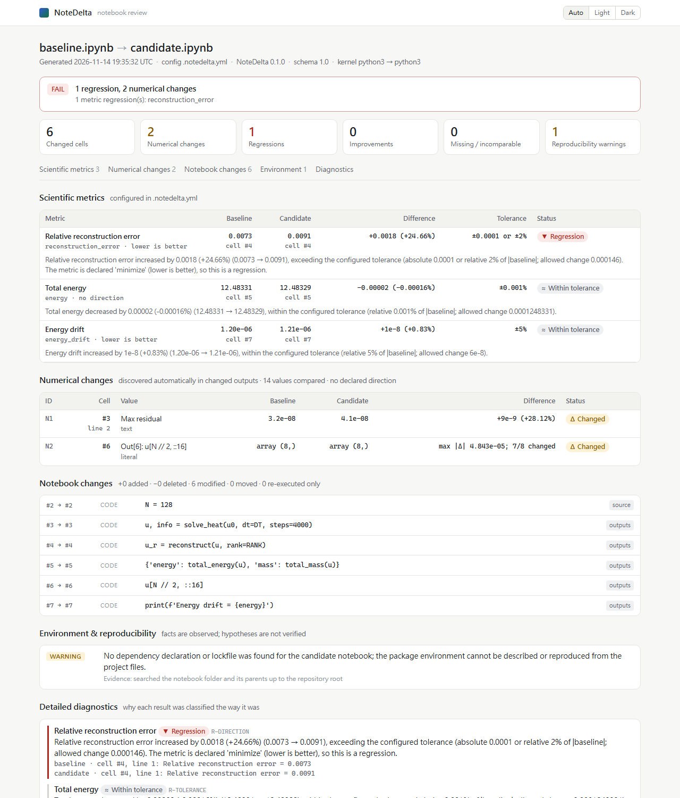

# NoteDelta

**Know what changed in your scientific results, not just your code.**

NoteDelta compares two versions of a Jupyter notebook and answers the question a code diff
cannot: *which numerical results changed, by how much, does that exceed what I consider
acceptable, and is there something about the environment I should check?*

- **Configured scientific metrics.** Declare a metric once: how to find it, whether
  lower or higher is better, and a tolerance. NoteDelta reports the exact difference,
  the relative change, and whether it is a regression, an improvement or within
  tolerance, and explains the rule it applied.
- **Automatic numerical discovery.** Numbers in changed outputs (logs, printed values,
  NumPy arrays, pandas tables, JSON) are paired and compared without configuration.
  Because their direction is unknown, they are reported as changes, never as regressions.
- **Reproducibility diagnostics.** Differences in kernel, Python version, locked package
  versions, dependency declarations, random seeds and execution order are each labelled
  as a *fact*, a *warning* or a *hypothesis*. NoteDelta never claims a cause it cannot show.

NoteDelta runs entirely offline, never executes notebook code during comparison, sends no
telemetry and needs no account.



> **Status: beta (0.1).** The VS Code extension and the GitHub Marketplace listing are in
> preparation. This repository hosts the documentation, the issue tracker, the licence and
> the GitHub Action. The source code is not public.

## Install

NoteDelta needs Python 3.11 or newer and runs on Windows, macOS and Linux.

```bash
pip install notedelta
pip install "notedelta[execute]"   # optional: opt-in notebook re-execution (runs code; not sandboxed)
```

## Quick look

```bash
notedelta compare baseline.ipynb experiment.ipynb
```

```text
NoteDelta  baseline.ipynb → candidate.ipynb
  1 regression, 2 numerical changes

Scientific metrics
  Metric                         Baseline  Candidate  Difference            Tolerance        Status
  Relative reconstruction error  0.0073    0.0091     +0.0018 (+24.66%)     ±0.0001 or ±2%   REGRESSION
  Total energy                   12.48331  12.48329   -0.00002 (-0.00016%)  ±0.001%          WITHIN TOL
    reconstruction_error: Relative reconstruction error increased by 0.0018 (+24.66%) (0.0073 → 0.0091),
    exceeding the configured tolerance (absolute 0.0001 or relative 2% of |baseline|; allowed change 0.000146).
    The metric is declared 'minimize' (lower is better), so this is a regression.
```

Declare the metrics you care about in `.notedelta.yml`:

```yaml
version: 1
metrics:
  - name: reconstruction_error
    label: Relative reconstruction error
    direction: minimize
    extraction:
      type: regex
      pattern: 'Relative reconstruction error\s*=\s*([0-9.eE+-]+)'
    tolerance: {absolute: 0.0001, relative: 0.02}
  - name: validation_accuracy
    direction: maximize
    unit: fraction            # shown as %, differences in percentage points
    extraction: {type: key_value, key: Validation accuracy}
    tolerance: {absolute: 0.002}
```

Use it as a check, locally or in CI:

```bash
notedelta compare a.ipynb b.ipynb --html report.html --fail-on-regression
notedelta compare-git notebooks/analysis.ipynb --ref main
```

Exit codes: `0` ok, `1` a fail-on condition was met, `2` invalid input or configuration,
`3` internal error.

## GitHub Action

This repository is also a GitHub Action that checks notebooks in pull requests. It writes
a job summary, uploads the HTML and JSON reports and needs only read permission. It
installs NoteDelta from PyPI.

```yaml
permissions:
  contents: read
jobs:
  notedelta:
    runs-on: ubuntu-latest
    steps:
      - uses: actions/checkout@v4
        with:
          fetch-depth: 0
      - uses: ouyang-matters/notedelta@v0.1.0
        with:
          notebooks: |
            notebooks/**/*.ipynb
          fail-on: regression,new_error
```

See [docs/ci.md](https://github.com/ouyang-matters/notedelta/blob/main/docs/ci.md) for all inputs.

## Documentation

| | |
|---|---|
| [Getting started](https://github.com/ouyang-matters/notedelta/blob/main/docs/getting-started.md) | a ten-minute tutorial with the bundled [examples](https://github.com/ouyang-matters/notedelta/tree/main/examples) |
| [CLI reference](https://github.com/ouyang-matters/notedelta/blob/main/docs/cli.md) | every command, option and exit code |
| [Configuration](https://github.com/ouyang-matters/notedelta/blob/main/docs/configuration.md) | the `.notedelta.yml` v1 specification |
| [Numerical comparison](https://github.com/ouyang-matters/notedelta/blob/main/docs/numerics.md) | formulas, tolerances, NaN/zero/precision handling, arrays and tables |
| [Classification rules](https://github.com/ouyang-matters/notedelta/blob/main/docs/classification.md) | every rule that can label a result |
| [Environment diagnostics](https://github.com/ouyang-matters/notedelta/blob/main/docs/environment.md) | what is inspected and how findings are graded |
| [Report format](https://github.com/ouyang-matters/notedelta/blob/main/docs/report-format.md) | the versioned JSON report ([schema](https://github.com/ouyang-matters/notedelta/blob/main/docs/report-schema.json)) |
| [VS Code extension](https://github.com/ouyang-matters/notedelta/blob/main/docs/vscode.md) · [GitHub Actions](https://github.com/ouyang-matters/notedelta/blob/main/docs/ci.md) | integrations |
| [Security and privacy](https://github.com/ouyang-matters/notedelta/blob/main/docs/security.md) · [Known limitations](https://github.com/ouyang-matters/notedelta/blob/main/docs/limitations.md) | |

Example reports generated by NoteDelta: [ML experiment](https://github.com/ouyang-matters/notedelta/blob/main/examples/reports/ml-experiment.html),
[numerical simulation](https://github.com/ouyang-matters/notedelta/blob/main/examples/reports/numerical-simulation.html),
[reproducibility](https://github.com/ouyang-matters/notedelta/blob/main/examples/reports/reproducibility.html). Download them and open locally;
they are self-contained HTML files.

## Feedback

Bug reports, questions and feature requests are welcome in
[Issues](https://github.com/ouyang-matters/notedelta/issues). Please report security
problems privately (see [SECURITY.md](https://github.com/ouyang-matters/notedelta/blob/main/SECURITY.md)).

## What NoteDelta is not

NoteDelta reports observable differences and applies the rules you configure. It does not
decide whether an experiment is scientifically valid or reproducible, does not infer
statistical significance from two values, and does not interpret images (plots are
compared by content hash). Interpretation remains the researcher's responsibility.

## License

Proprietary freeware, see [LICENSE](https://github.com/ouyang-matters/notedelta/blob/main/LICENSE). It is free to use, including commercially.
Third-party components keep their own licences ([THIRD_PARTY_NOTICES.md](https://github.com/ouyang-matters/notedelta/blob/main/THIRD_PARTY_NOTICES.md)).
